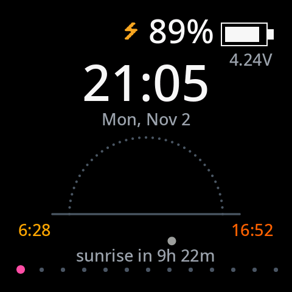
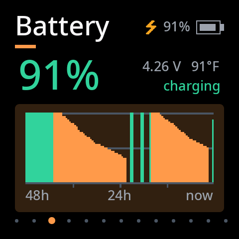
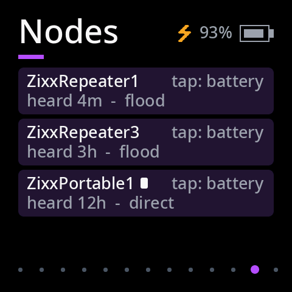
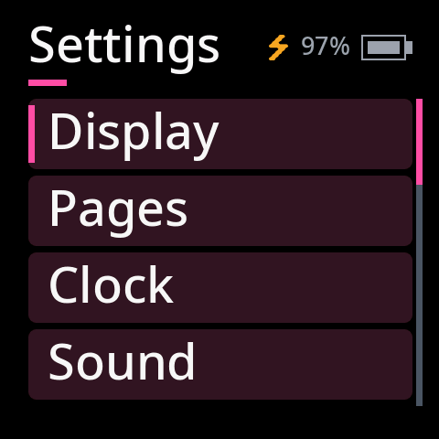
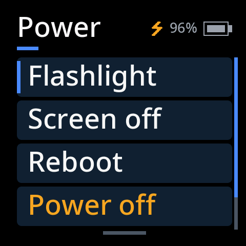

<div align="center">

# MeshCore for the LilyGo T-Display-SF32

**A pocket MeshCore node with a 480x480 AMOLED touch screen.**

Companion (phone app over Bluetooth, with its own touch UI) · Repeater · Room server


  

</div>

MeshCore firmware for the LilyGo T-Display-SF32 (SiFli SF32LB52 + SX1262 LoRa + 480x480
AMOLED). It's built on the LilyGo SiFli SDK and LilyGo's C RadioLib port; MeshCore itself
is used unmodified.

The companion is a **handheld node**, not a messenger: the phone does the messaging, the
device shows what's happening on the mesh, tests links, finds repeaters and keeps time.

---

## Contents

- [Highlights](#highlights)
- [Screenshots](#screenshots)
- [Firmwares](#firmwares)
- [Getting started](#getting-started)
- [Using the companion](#using-the-companion)
- [Repeater and room server](#repeater-and-room-server)
- [Battery and power](#battery-and-power)
- [Status and to-do](#status-and-to-do)
- [Development](#development)
- [License and credits](#license-and-credits)

## Highlights

| | |
|---|---|
| 🕐 **6 clock faces** | Color, Sun (sunrise/sunset arc), Digital, Analog, Big, Info. Hold the clock to switch |
| 📡 **Signal tools** | Signal tester, repeater **finder** (warmer/colder), 902-928 MHz **band scan** |
| 📊 **Mesh at a glance** | Activity graph, heard nodes, **My Nodes** with on-demand battery |
| 🔋 **Battery** | 48 h history graph, time left, low-battery protection |
| 🆘 **Mesh SOS** | Triple-press A: location + battery to a channel, repeated |
| 🔦 **Extras** | Flashlight (white/red), share contact QR, auto adverts, mesh time, rotation |
| 💻 **USB app** | MeshCore app protocol over USB too: PC tools and a raw-packet **observer** |
| 🎨 **Themes** | 9 colour themes plus Rainbow, night mode, always-on display, tap sounds |

## Screenshots

<table>
<tr>
<td align="center"><br><sub>Color face</sub></td>
<td align="center"><br><sub>Sun face</sub></td>
<td align="center"><br><sub>Analog face</sub></td>
<td align="center"><br><sub>Big face</sub></td>
</tr>
<tr>
<td align="center"><br><sub>Battery history</sub></td>
<td align="center"><br><sub>Radio</sub></td>
<td align="center"><br><sub>Band scan</sub></td>
<td align="center"><br><sub>My Nodes</sub></td>
</tr>
<tr>
<td align="center"><br><sub>Info face</sub></td>
<td align="center"><br><sub>Settings</sub></td>
<td align="center"><br><sub>Display settings</sub></td>
<td align="center"><br><sub>Power menu (swipe down)</sub></td>
</tr>
</table>

## Firmwares

| Firmware | Build | Use it for |
|---|---|---|
| **Companion** | `./build.sh companion` | Your own node: pairs with the MeshCore phone app over Bluetooth, full touch UI |
| **Repeater** | `./build.sh repeater` | Extending the mesh. Configure with [config.meshcore.io](https://config.meshcore.io) |
| **Room server** | `./build.sh room_server` | A shared message board on the mesh |

All three share the node identity and settings on the board's flash, which survive reflashing.

## Getting started

You need Linux or macOS with bash or zsh, git, and the board on USB.

1. Get the [LilyGo SiFli SDK](https://github.com/Xinyuan-LilyGO/SlFli-SDK-Lilygo) v2.5.1
   (folder `sifli-sdk-v2.5.1`) and install its toolchain as LilyGo describes. Also clone the
   upstream [SiFli SDK](https://github.com/OpenSiFli/SiFli-SDK): LilyGo's download lacks
   `rtos/env/packages`.
2. Run setup. It fetches MeshCore into `lib/MeshCore` (pick a version with
   `MESHCORE_REF=<tag>`; developed against v1.18.0), applies the SDK fixes in
   `sdk-patches/`, and links the SDK at `~/sifli-lilygo-sdk` (its build breaks on paths
   with spaces):
   ```sh
   ./setup.sh /path/to/sifli-sdk-v2.5.1 /path/to/SiFli-SDK
   ```
3. Build and flash:
   ```sh
   ./build.sh companion && ./flash.sh companion
   ```

```sh
./build.sh [repeater|room_server|companion]   # default: repeater
./flash.sh [repeater|room_server|companion]   # flash over USB (auto-picks the port)
./monitor.sh                                  # serial console at 115200; Ctrl+] to quit
```

> [!TIP]
> **Serial port permission on Linux:** add yourself to the `uucp`/`dialout` group, or add a
> udev rule such as `SUBSYSTEM=="tty", ATTRS{idVendor}=="1a86", MODE="0666"`.
> From fish, run the scripts as normal; they start bash themselves.

> [!IMPORTANT]
> **Battery switch:** the red I/O switch on the board disconnects the battery. On **O** the
> board only runs on USB, loses its clock on unplug, and the charger cycles with nothing
> attached. Keep it on **I**.

## Using the companion

### Pairing

The board advertises as `MeshCore-<name>`. On first connect the phone asks for a PIN: it's
the 6-digit **Pin** shown on the screen (new each boot until a phone is paired). Pairing
uses LE Secure Connections with bonding, so later connections need no PIN.

> If a phone was paired with older test firmware, remove the device from the phone's
> Bluetooth settings first.

### Gestures

| Gesture | Does |
|---|---|
| **Swipe left / right** | Next / previous page |
| **Tap** or button **A** | Next page (double tap: previous; long press: select) |
| **Swipe down** | Power menu: Flashlight, Screen off, Reboot, Power off, Send SOS |
| **Swipe up** | The current page's menu, plus **Settings** |
| **Swipe right** in Settings | Back one level |
| **Hold** the clock | Next clock face (a ring fills; at 0.6 s it changes with a pop) |
| **Triple-press A** | Mesh SOS |

Any touch wakes a dark screen. Woken within 10 s, it comes back where it was; after that,
on the clock. Long lists follow your finger and glide after a flick.

### Pages

| Page | Shows |
|---|---|
| **Clock** | Time, date, unread envelope (tap to read), battery. Six faces |
| **Status** | Unread, messages waiting for the app, Bluetooth PIN or node name |
| **Battery** | Charge, voltage, chip temperature, time left, 48 h graph |
| **Heard** | Recently heard nodes |
| **Radio** | Frequency, BW, SF, CR, TX power, noise floor. Menu: edit radio, band scan |
| **Bluetooth** | Connection; menu: turn off, forget paired phones |
| **Advert** | Send an advert (long press: nearby or whole mesh, your choice) |
| **Bot** | Optional auto-reply to senders using 1-byte path hashes (off by default) |
| **Discover** | Scan for nearby nodes |
| **Signal** | Signal tester and repeater finder |
| **Activity** | Packets per hour over 24 h and how busy the channel is |
| **Nodes** | Your favourite contacts: last heard, hops, battery on tap |
| **Power** | Tap for the power menu |

Pages can be hidden in **Settings > Pages** (the clock always shows).

### Settings

| Menu | Contains |
|---|---|
| **Display** | Theme, clock face, brightness, timeout, always-on, rotation (Normal / Auto / Right / Upside down / Left) |
| **Pages** | Show or hide each home page |
| **Clock** | Time zone, daylight saving (off/US/EU), 12/24 h, mesh time, reset clock |
| **Sound** | Volume, new-message alerts (all / direct / off), tap sound (click / pop / tick / off) |
| **Night mode** | From, until, dim and how far, do not disturb |
| **Motion** | Lift to wake, flip to quiet |
| **Bluetooth** | On / off (remembered) |
| **USB app** | The app protocol over USB as well (off by default) |
| **Auto advert** | Nearby every 1/3/6/12 h, mesh every 12/24/48 h (both off by default) |
| **SOS to** | The channel Mesh SOS goes to |
| **Low power** | Let the chip sleep with the screen off (on by default) |
| **Logs** | The last 20 events; tap one for a board snapshot |
| **Power** | Screen off, reboot, power off |

Saved in `/sf32_ui` on the board.

### Features in detail

<details>
<summary><b>Clock faces</b></summary>

- **Color**: a rainbow ring of minute dots filling up through the hour, a colour per digit, on true black.
- **Sun**: the day as an arc from sunrise to sunset with the sun on it, a pale moon below
  at night, the times and how long until the next. Worked out on the device from the
  node's location as set in the app (the sunrise equation; no network).
- **Digital**, **Analog**, **Big** (stacked hours and minutes), **Info** (time plus unread,
  battery, phone and last-heard cards; also shows the next sunrise or sunset).

Switch by holding the clock, from its swipe-up menu > Face, or Settings > Display > Clock face.
The time comes from the phone app when it connects; until then the clock shows `--:--`.
</details>

<details>
<summary><b>Time zone</b></summary>

Settings > Clock > Time zone: **-** / **+**, **Done** (button A: click = +1 h, double
click = -1 h, long press = done). The phone can't set it: MeshCore's companion protocol only
sends UTC. With **Daylight saving** set to US or EU, the zone is your standard time (e.g.
UTC-5 for US Eastern) and summer time is added automatically. It's MeshCore's own
`tz_offset` setting (also `set tz.offset N` via the app's CLI).
</details>

<details>
<summary><b>Signal tester and repeater finder</b></summary>

**Signal tester** (Signal page, tap to start/stop): every 10/15/30/60 s it pings the
repeaters in direct range (zero-hop discovery) and shows how well the best one hears us and
we hear it (SNR), its name, replies/pings and a graph of the last 40 pings (no reply: red
tick). A beep per ping, higher for a better link. Swipe up > Target locks onto the repeater
just heard. The screen stays on while testing; it stops by itself after 30 min.

**Finder** (Signal menu): locked onto one repeater, a ping every 5 s, its signal strength
big (RSSI, which keeps rising as you get close) and **warmer / colder / about the same**
against the last few pings, the best so far, and a beep whose pitch follows the strength.
No compass on the board, so no direction: walk, and follow the trend.
</details>

<details>
<summary><b>My Nodes</b></summary>

The contacts you starred as favourites in the app (up to 4): when each was last heard,
direct / hops / flood, and its battery **when you tap its row**: one telemetry request to
that node, at most one every 20 s and nothing on a schedule, so the mesh isn't loaded with
polling. A node answers only if its own telemetry setting shares with you; repeaters want a
login for it ("no reply").
</details>

<details>
<summary><b>Activity</b></summary>

Packets heard in the last hour and 24 h, how busy the channel is (share of the time the
radio spent receiving or sending) and packets per hour as a bar graph. From the radio's own
counters: no extra traffic. RAM only (starts over at boot).
</details>

<details>
<summary><b>Radio editor and band scan</b></summary>

**Edit radio** (Radio page menu): one card per setting (Preset, Frequency, BW, SF, CR, TX
power). Tap one for its own screen with saved vs new value, **-** / **+** (frequency has a
step size and is limited to 902-928 MHz) and **Done**. Changes are tinted amber; **Apply N
changes** lists them (old -> new) to confirm. Nothing reaches the radio until then.
Presets: MeshCore's USA/Canada, Australia and New Zealand (narrow).

**Band scan** (Radio page menu): the noise level across 902-928 MHz in 250 kHz steps, swept
continuously, with max-hold marks, our channel marked, and the strongest frequency below.
MeshCore keeps receiving while it runs. Tap to reset.
</details>

<details>
<summary><b>Messages</b></summary>

The device shows messages but doesn't send them: no typing or replies, by design. A new
message that alerts (Settings > Sound > Alerts) shows a banner at the top for 6 s with the
sender and the start of the text. Tap the envelope on the clock to read; swipe left for the
next, right to go back. Messages count as read once the phone app downloads them, or when
viewed on the device. **Do not disturb** (Night mode) keeps them silent and dark.
</details>

<details>
<summary><b>Mesh SOS</b></summary>

Triple-press button A, or swipe down > Send SOS. After a 5 s countdown with beeps (Cancel,
or press A), it sends "SOS! I need help. Location: lat,lon. Battery N%." to the channel in
Settings > SOS to (default: the first channel, usually Public), and repeats every 5 min, 6
times in all, until you tap Stop. The location is the node's as set in the app.
</details>

<details>
<summary><b>Auto advert</b></summary>

Send adverts on a schedule, as repeaters do, so other nodes keep a fresh path: **Nearby**
(zero hop) every 1, 3, 6 or 12 h and **Mesh** (flood) every 12, 24 or 48 h. The Advert,
Heard and Radio page menus have **Send nearby** and **Send to mesh**; the Advert page's
menu > **Long press** picks what its long press sends.
</details>

<details>
<summary><b>USB app (PC tools and observer)</b></summary>

Settings > USB app (off by default): the MeshCore app protocol over the USB serial port as
well as Bluetooth, both at once. Use it with PC apps (meshcore-cli, the Python library) or
as an **observer**: every packet heard is pushed raw with its SNR / RSSI
(`PUSH_CODE_LOG_RX_DATA`), for logging or an MQTT bridge on the PC. 115200 baud on the
CH343 port; flashing still works. Nothing is written until an app sends a frame.
</details>

<details>
<summary><b>Mesh time</b></summary>

While the clock isn't known (battery ran flat, battery switch, fresh flash), the times in
received adverts set it once 3 different nodes agree within 5 minutes. The clock shows
"(mesh)" after the date until the phone syncs. Only nodes already in your contacts count;
outliers are ignored. **Reset clock** (Settings > Clock, tap twice) sets the clock back to
"unknown", the way out of a wrong time ahead (MeshCore only moves the clock forward).
</details>

<details>
<summary><b>Share QR, flashlight, rotation</b></summary>

- **Share QR** (Clock or Status page menu): this node as a QR code for the MeshCore app to
  scan (`meshcore://contact/add?...`).
- **Flashlight** (power menu): the whole panel at full brightness, white or red (tap
  switches; red keeps night vision), 5 min unless touched.
- **Rotation** (Settings > Display): Normal, Right, Upside down, Left, or **Auto** (the way
  it's held, from the accelerometer; lying flat keeps the last). Touches turn with it.
</details>

<details>
<summary><b>Display, sound and motion options</b></summary>

- **Themes**: MeshCore blue, cyan, teal, green, purple, pink, red, orange, mono, and
  Rainbow (every page in its own hue).
- **Always-on**: instead of going dark, the time, date and an unread envelope on black at
  6 % brightness, moved each minute (burn-in care).
- **Night mode**: a lower brightness between two hours and/or do not disturb. There's no
  light sensor for auto brightness.
- **Timeout**: 15 s, 30 s, 1 min, 5 min, or never while on USB (then it dims after a minute).
- **Sound**: chime volume off / low / medium / high; tap sounds click / pop / tick plus a
  whoosh on swipes. No vibration motor on this board.
- **Lift to wake**: lying still, then tilted, turns the screen on (walking or a pocket
  doesn't). **Flip to quiet**: face down turns the screen off and silences alerts.
</details>

<details>
<summary><b>Bot (optional)</b></summary>

Off by default; tap the Bot page to turn it on. It auto-replies to messages sent with
**1-byte path hashes**, asking the sender to switch to 2-byte. Swipe up for options:
**Auto-reply**, **To DMs**, and **Channels** (off / DM back / post in the channel). Each
sender gets it at most once a day, at most one reply a minute, never to auto-replies.
</details>

## Repeater and room server

Configure them with [config.meshcore.io](https://config.meshcore.io) (Chrome/Edge, USB, the
CH343P port): the board speaks MeshCore's stock serial CLI at 115200 baud. Over LoRa, use
Remote Management in the MeshCore app.

| Default | Value |
|---|---|
| Radio | USA/Canada preset: 910.525 MHz, BW 62.5, SF7, CR 4/5, 22 dBm |
| Names | Repeater "SF32 Repeater", room server "SF32 Room" (room password "hello") |
| Admin password | **"password"**: change it |

The screen shows MeshCore's repeater/room screen and turns off after 20 s. Button **A**
turns it on; holding A for 1 s powers off. To power on, press **D** (the charger's button
on the bottom edge, below the antenna) or plug in USB.

<details>
<summary><b>Board-specific CLI commands</b></summary>

| Command | Does |
|---|---|
| `battery` | Battery voltage over 20 samples, USB, charger state and faults |
| `charger` | Raw SGM41562B registers 00-0B, plus HIZ / CEB / FET_DIS |
| `charger test` | (USB only) Pauses charging for 3 s and reads VBAT (0 V = no battery) |
| `clock reset` | (USB only) RTC back to MeshCore's default start date |
| `buttons` | Levels and change counts for buttons C, A, B |
| `display on` / `display off` | Screen |
| `noise` / `noise test` / `noise scan FROM TO STEP` | Radio background level, tests and sweeps (kHz; USB only) |
| `i2c scan` | Devices on the I2C buses |
| `wdt test` | (USB only) Stalls the main loop; the watchdog reboots in about a minute |
</details>

## Battery and power

- **Battery life** (companion, screen mostly off): about **28-30 hours** on the 480 mAh
  battery. Work on reducing the screen-off draw is ongoing.
- **Low power** (on by default): the chip light-sleeps whenever the screen is off; the
  radio keeps listening and Bluetooth stays up. It stays awake on USB (charging), which
  keeps flashing working.
- **Charge shown**: from the battery voltage. While charging (which lifts the voltage) it
  carries on from the reading before USB at the charger's pace, and shows 100 % only when
  the charger reports done.
- **Warnings**: a popup at 20 %; at 10 % it also wakes the screen.
- **Protection**: on battery below 3.55 V for 30 s the board powers off (same threshold as
  LilyGo's factory firmware).
- **Clock**: kept across reboots and the menu's power off; lost on a battery-empty
  shutdown, with the battery switch off, and on flashing.

## Status and to-do

Working: all three firmwares, Bluetooth pairing, touch UI, sleep, sound, motion, USB app.

- **Power**: find what draws ~16 mA with the screen off (counters in `sf32_pm_stats`,
  read with `tools/pmstats.sh`); then fewer wake-ups and deeper sleep.
- **WiFi**: needs the T-SF32-Keyboard expansion's ESP32-C6 (per LilyGo).
- Noise floor reads about -106 dBm vs -115 on a T1000-E nearby (broadband; a spur at
  912 MHz from the board's own clock).

## Development

Internals, build details, SDK patches, debugging over the debug UART, screenshots and test
builds are in **[docs/DEVELOPMENT.md](docs/DEVELOPMENT.md)**.

```
project*/         one SiFli/SCons project per firmware
src/main.cpp      runs MeshCore's setup()/loop() as the RT-Thread main thread
src/platform/     board support: battery, radio, display, touch, BLE, USB, RTC, motion, sound
src/arduino/      a minimal Arduino layer for MeshCore
src/companion_ui/ the companion's screen UI (MeshCore's ui-new plus ui_*.inc)
lib/              vendored libraries; MeshCore is fetched by setup.sh, unmodified
tools/            flashing helper, screenshots, remote touch, font generator
sdk-patches/      fixes the LilyGo SDK needs (applied by setup.sh)
```

## License and credits

MIT, see [LICENSE](LICENSE). Bundled code and the font keep their own licenses: see
[THIRD_PARTY.md](THIRD_PARTY.md) and `licenses/`. Built on [MeshCore](https://github.com/meshcore-dev/MeshCore),
the LilyGo SiFli SDK, Noto Sans (SIL OFL) and Nayuki's QR code generator (MIT).
